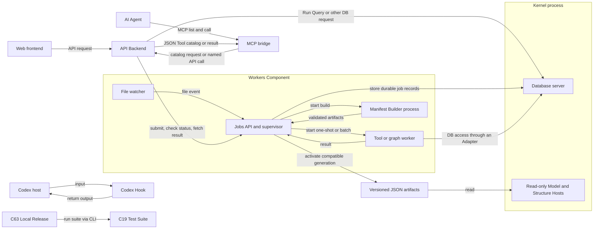
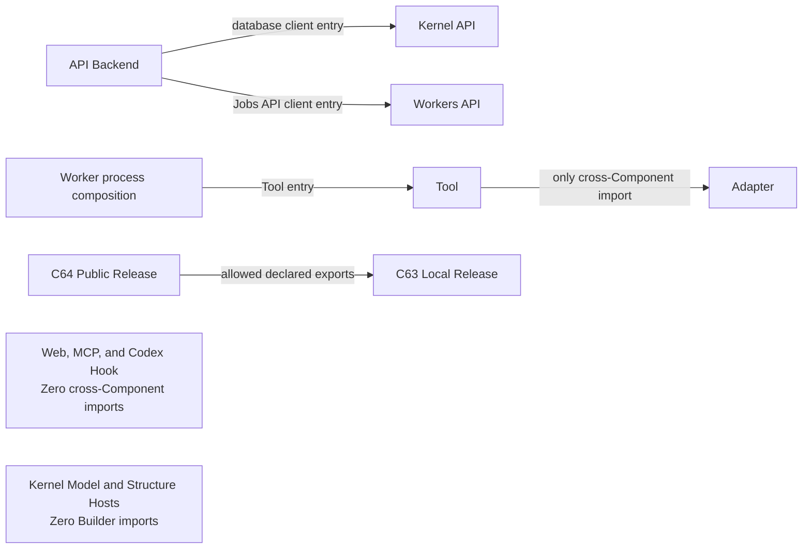

## Summary

Define and apply Component import boundaries

## Status

The Operator resumed the Epic with `/goal complete the epic`.
AN-T-2972 completed the first behavioral testing task.

## Objective

Give each current Component an authored Contract and declare the Code Access,
state, and interfaces that its Realization needs.

## Review checkpoint

- **Behavioral baseline.** AN-T-2972 reviewed the last 48 hours of MCP
  errors. The new session health probe, query canary, and Docker session
  continuity test passed. Use these gates during import-boundary repairs.

- **Framework Delivery (C27).** The current Python scan found zero imports
  outside the Release subtree. The three resolved imports within it dispatch
  to Local Release (C63) and Public Release (C64).
- **Release interfaces.** Local Release calls the C19 Test Suite CLI for
  static and functional checks, then end-to-end and canary checks on the
  candidate image. Public Release drafts the PR description
  and brief Version History entry from completed Tickets and a Luna review of
  the pinned Git diff. Contracts and exact bindings are in place for C27,
  C63, and C64.
- **Entry Modules and manifests.** The implemented entry Modules use
  `__shared` and `__pub`. AN-T-2945 and AN-T-2946 still need coverage checks
  for each Component and its code-bearing Packages. Use `boundaries.code`
  for Code Access in AN-T-2945.
- **Engine Studio (C14).** Backend owns Tool discovery, Project routing,
  dispatch, and Tool failure results. MCP maps the Backend JSON API. The
  realization graph finds zero MCP production cross-Component imports or
  unresolved production sites. The MCP package binds AN-S-3191@3.
- **Realization Graph.** The current Python scan verified 1,320
  cross-Component imports with zero denied and zero unresolved occurrences.
  Declared script roots and namespace resolution identify local targets.
  Four imports identify external modules in previous runtime images.
  The Codex Hook (C49) has zero production cross-Component imports.
- **Runtime Setup (C65).** The scan confirmed zero resolved cross-Component
  imports. The installation work is complete in standalone Task AN-T-2969.

## Solution

### Approach

Use three server-side Components. The API Backend serves Web and MCP.
It calls the Workers API for job submission, status, and results. It
calls the Kernel directly for database requests. Interactive Run Query
uses this direct path, so a query can return without starting a worker.

### MCP bridge

Backend owns the APIs available to AI Agents and publishes their Tool
catalog as JSON. Each exposed entry provides the Tool name, description,
and input schema. Use the same Backend definitions for catalog entries
and dispatch.

MCP maps catalog entries to MCP Tools, forwards the Tool name, arguments,
and request context to Backend, then returns the result or failure through
MCP. Backend owns Project admission, Tool availability, and operation
validation. MCP can read the Project Manifest and runtime settings
through declared calls. Runtime Setup and Workers own their release
and job duties.

Verify catalog parity and forwarding through the real MCP and Backend
processes. Cover Project-specific availability, invalid requests, and
provider failures. Verify zero production cross-Component imports from MCP.

The Kernel is the database server for each Project. Its Model Host and
Structure Host are read-only interfaces in the same process. They expose
one compatible generation of JSON schemas and Structure data.

The Workers supervisor receives file events and starts one-shot or batch
workers. Tool operations, graph builds, and the Manifest Builder run
there. The supervisor owns the job lifecycle and stores durable job
records through the Kernel. A separate Builder process releases its
build memory at exit. Publish a compatible Model and Structure generation
atomically and keep the previous generation available on failure.

The Codex Hook processes host input and returns output to the host.
C27 Framework Delivery exposes the `local` and `public` Release commands.
Local Release calls the Test Suite through its public CLI. Public Release
can use declared Local Release interfaces.

### Processes and calls

Arrows show runtime calls, host input and output, or artifact handoffs.

### Code imports

This is the target import structure. Process calls use public interfaces. Where code imports a client entry
Module, record the exact export in the caller's allowance. Tools import
only Adapters across Components. Adapters import zero other Components.
Web, MCP, and the Hook have zero cross-Component imports. The Kernel's
reader interfaces import zero Builder code.

Record exact providers and entry Modules in Component Manifests. Bind
their Contracts to the owning Packages for the target architecture.
See Spec Proposal `AN-T-2958@1-draft` for detailed rules and acceptance
checks.

## Execution order

1. **Add behavioral tests.** Start with AN-T-2972. Review the most recent
   48 hours of MCP errors and add end-to-end or canary regression coverage
   for verified bugs. Exercise successful requests, refusals, and
   recovery through the real CLI and API. Run end-to-end checks across
   Components on the exact candidate image. Keep the canary short: verify
   startup, initialize MCP, and execute one representative query.
2. **Fix forbidden cross-Component imports.** Refresh the graph, then work
   from the highest Layer down. Verify each repair with the matching
   behavioral checks. Track unresolved sites separately from confirmed
   violations and keep Package-only findings outside this pass.
3. **Apply source size limits.** Use 300 lines per file and 45 lines per
   function as review targets during repairs. Enforce the limits across
   the applicable source once the Component boundaries are settled.
4. **Retire redundant unit tests.** For each removal, identify the
   behavioral check that covers its guarantee. Replace the release unit
   gate with fast functional checks and linting when that coverage is ready.

Refactor into Backend, Kernel, and Workers after those steps. Reuse the
behavioral gates throughout the refactor.

## Work

1. In step 2, resume AN-T-2949 in Engine Studio (C14). Start with MCP imports from
   Tools and Workbench Backend. Continue in descending Layer order. Verify
   each repair against declared ownership and Code Access. Track unresolved
   imports and keep Package-only findings outside this pass. Apply the MCP
   bridge through the Backend JSON catalog and named API dispatch. Record
   that boundary in the MCP Manifest, Contract, and Tier 1 Solution.
   Keep AN-T-2976 queued until the MCP bridge passes its import and
   behavior checks.
2. Complete AN-T-2945. Declare Code Access under `boundaries.code`. Record
   runtime interfaces under `boundaries.io` and owned state under
   `boundaries.state`.
3. Complete AN-T-2946. Check each code-bearing Package separately. Prefer
   one `__shared` entry Module for the parent and siblings. Add `__pub`
   when a public interface is needed. Keep implementation Modules unmarked
   and Package-local.
4. Complete AN-T-2947. Write each Component Contract with a verifiable
   guarantee and implement its interface.
5. Complete AN-T-2948. Bind exact Contract revisions to their Realization
   Packages.
6. Refactor to the target architecture after resolving forbidden
   cross-Component imports. Use Component Seed as the name for a Package
   with its own Spec that may later become a Component.
