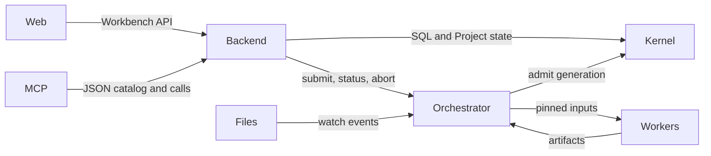

## Summary

Run Studio in one supervised container

## Claim

### Prose Claim

Run Kernel, Orchestrator, Backend, and MCP as separate long-lived processes in one container. Kernel owns the Project database through Database Server C71. Its read-only Model and Structure Hosts expose the same admitted generation. Kernel commits artifacts and projection rows together. Orchestrator owns the watcher and job state. Isolated Workers build from pinned inputs. Backend serves Web and MCP and keeps durable Project state in Kernel.

Restart Backend and MCP independently. If Kernel or Orchestrator exits, replace the affected Project's pair and re-admit it. Keep the container's existing memory and OOM policy. Use one warm Worker for small Ticket batches. Orchestrator waits at most the measured spawn-to-ready time before using a cold Worker. Larger supported batches use one cold Worker. Keep restart fingerprints by path and content so catch-up detects deletions.



Web and MCP use Backend's API with zero cross-Component imports. The Codex Hook returns its Project assertion to the host with zero cross-Component imports or outbound calls. Tools may import across Components only from Adapters. Adapters import no other Component. Declare Code Access, calls, and state in Manifests. Bind exact Contracts to the owning Packages.

Use one `stack` selector in `LAYER_3_DEVOPS_C80/LAYER_2_RELEASE_C27/project.toml`. The parallel Components use `<name>_beta_<id>`. Use `beta_next` for the supervised stack and keep `current` selectable.

Compare the immutable candidate and baseline images with the same fixture.
Check each discrepancy against its Contract before cutover.

Studio waits for the Project watcher's coverage baseline before
capture. Admit the pinned capture as a base and replay the covered
changes through the completed observation before reporting readiness.

If coverage is lost, reconcile the affected inputs and use a broader
capture if their scope is unknown. Require source proof for external
and unwatched inputs.

Incremental Startup is the default with a compatible, verified
projection checkpoint. Compare the deterministic folder and path
inventory and carrier content hashes. Reuse the unchanged projection
and apply only additions, edits, moves, and deletions.

Use a full reload when the projection database or checkpoint is missing,
the checkpoint is incompatible or cannot be verified, or a Model,
Structure, or compiler schema input changed. When only Realization
Graph inputs changed, rebuild the Graph with the admitted Model and
Structure.

For a full rebuild, a Worker stages complete rows from one pinned
snapshot in batches of about 10 MiB. Orchestrator passes the artifact
pin to Kernel. Kernel validates the artifact and publishes the full
generation in one DuckDB transaction. Failed admission preserves the
previous generation. Incremental changes use the existing delta path.

Finish Current and Draft catch-up before Studio reports readiness.
Reconcile Archive in a background Worker. Archive from a previous
checkpoint may remain visible with an explicit pending status. On
cold startup, expose Archive after its admission. Require complete
Archive before admitting lifecycle writes.

Detect live Project Manifest edits through the source watcher. When
the digest changes, the supervisor validates the new binding and
reloads the affected Project in the running container.

Run one Manifest Builder per selected Project at a time. Within the
pinned owner, coalesce Manifest input changes during a build into one
follow-up for the newest observed inputs.

Preserve admitted artifacts after a formatting-only edit when
compatibility is verified. Rebuild only the artifacts affected by a
settings or schema change.

Publish the exact Model and Structure together in one Kernel admission.
Mark affected data pending and block affected writes until Kernel
admits the generation for the newest observed inputs.

Index the title of each Atom Summary. Keep the full Summary in its
carrier. Compile a candidate Model from the captured sources.
If the candidate fails, retain the compatible last-good Model and
Structure and publish a diagnostic.

Report an invalid Project Manifest explicitly. Mark the Project
unready and block affected writes while its Manifest is invalid.

### Formal Claim

This claim covers only the readiness condition for a pair, not runtime conformance.

```lean
theorem pair_ready_requires_both (kernel orchestrator : Bool)
    (h : (kernel && orchestrator) = true) :
    kernel = true ∧ orchestrator = true := by
  cases kernel <;> cases orchestrator <;> simp_all
```

## References

AN-S-3191, AN-S-3335, AN-S-3336, AN-S-3339, AN-S-4810@3, and AN-T-2958.
