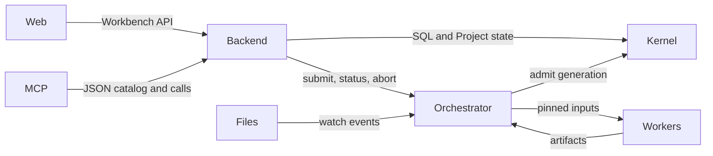

## Summary

Run Studio in one supervised container

## Claim

### Prose Claim

Run Kernel, Orchestrator, Backend, and MCP as separate long-lived processes in one container. Kernel owns the Project database through Database Server C71. Its read-only Model and Structure Hosts expose the same admitted generation. Kernel commits artifacts and projection rows together. Orchestrator owns the watcher and job state. Isolated Workers build from pinned inputs. Backend serves Web and MCP and keeps durable Project state in Kernel.

Restart Backend and MCP independently. If Kernel or Orchestrator exits, replace the affected Project's pair and re-admit it. Keep the container's existing memory and OOM policy. Use one warm Worker for small Ticket batches. Orchestrator waits at most the measured spawn-to-ready time before using a cold Worker. Larger supported batches use one cold Worker. Keep restart fingerprints by path and content so catch-up detects deletions.

Web and MCP use Backend's API with zero cross-Component imports. The Codex Hook returns its Project assertion to the host with zero cross-Component imports or outbound calls. Tools may import across Components only from Adapters. Adapters import no other Component. Declare Code Access, calls, and state in Manifests. Bind exact Contracts to the owning Packages.

Use one `stack` selector in `LAYER_5_FRAMEWORK_DELIVERY/project.toml`. The parallel Components use `<name>_beta_<id>`. Compare the two immutable images with the same fixture and check each discrepancy against its Contract. The verified Beta stack is the production selection.

## References

AN-S-3191, AN-S-3335, AN-S-3336, AN-S-3339, AN-S-3340, and AN-T-2958.
