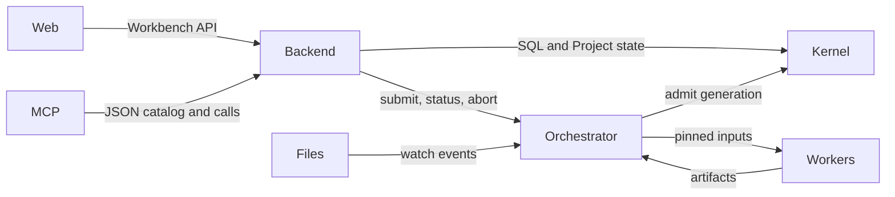

## Summary

Run Studio in one supervised container

## Claim

### Prose Claim

Run Kernel, Orchestrator, Backend, and MCP as separate long-lived processes in one container. Kernel owns the Project database through Database Server C71. Its read-only Model and Structure Hosts expose the same admitted generation. Kernel commits artifacts and projection rows together. Orchestrator owns the watcher and job state. Isolated Workers build from pinned inputs. Backend serves Web and MCP and keeps durable Project state in Kernel.

Restart Backend and MCP independently. If Kernel or Orchestrator exits, replace the affected Project's pair and re-admit it. Keep the container's existing memory and OOM policy. Use one warm Worker for small Ticket batches. Orchestrator waits at most the measured spawn-to-ready time before using a cold Worker. Larger supported batches use one cold Worker. Keep restart fingerprints by path and content so catch-up detects deletions.



Web and MCP use Backend's API with zero cross-Component imports. The Codex Hook returns its Project assertion to the host with zero cross-Component imports or outbound calls. Tools may import across Components only from Adapters. Adapters import no other Component. Declare Code Access, calls, and state in Manifests. Bind exact Contracts to the owning Packages.

Use one `stack` selector in `LAYER_3_DEVOPS_C80/LAYER_2_RELEASE_C27/project.toml`. The parallel Components use `<name>_beta_<id>`. Compare the two immutable images with the same fixture and check each discrepancy against its Contract. The verified Beta stack is the production selection.

Studio starts the watcher before capture and uses its completed
observations to guard admission. Incremental Startup is the default
with a compatible, verified projection checkpoint. Compare the
deterministic folder and path inventory and carrier content hashes.
Reuse the unchanged projection and apply only additions, edits, moves,
and deletions.

Use a full reload when the projection database or checkpoint is missing,
or when the checkpoint is incompatible or cannot be verified.
After a watcher coverage gap, restore coverage and reconcile the watched
source inventory against the admitted checkpoint. Apply the carrier delta
and reconcile Archive and Realization Graph in the background.

When compiler inputs change, recompile the Model from Manifests and
compile the affected Structure. Compare the projected column names and
types with the admitted database schema. Rebuild the database for this
change only if the columns change. Otherwise publish the Model and
Structure together and update affected rows and relation indexes in place.
For an enabled Realization Graph, check its inputs after foreground
readiness and the initial Archive job settles. Check every 10 minutes
by default. Skip an unchanged Graph.
Expose `query_rebuild(target="realization_graph")` through the API and MCP
for immediate refresh. Requests share one short-lived Worker per Project.
Use the admitted Model and Structure. Pass a pinned Graph artifact to
Kernel for admission and keep only job state in Orchestrator.

Finish Current and Draft catch-up before Studio reports readiness.
For an incremental start, fetch and validate only the foreground
checkpoint before readiness. Fetch and validate the Archive checkpoint
in the background.
Scan Archive filenames for the maximum version of each Atom ID.
Load Archive content in a background Worker. Archive content may be
pending while lifecycle operations use the admitted version data.
Operations that need exact Archive content wait for its admission.

The watcher adds Archive changes to the normal queue. Process them
after the initial Archive load. Skip a stale item if its source
changed or vanished. Process any newer event through the same queue.

Project only declared Content Properties. The native Atom index uses
the first line of the declared Summary. Read that field directly.

Detect live Project Manifest edits through the source watcher. Validate
the new binding and reload the affected Project in the running
container. Preserve admitted artifacts after a formatting-only edit
when compatibility is verified. Rebuild only the artifacts affected
by a settings or schema change.

Report an invalid Manifest explicitly. Mark the affected Project as
unready while the Manifest is invalid, and block affected writes.

### Formal Claim

For the selected Beta Project, Studio confirms the Project binding, both
processes' readiness, and Current and Draft catch-up from Orchestrator C68.
It reports an invalid Manifest separately. It can observe Kernel and
Orchestrator readiness in either order.

```python
component_workflow(
    component='C14',
    action='admit_studio_readiness',
    machine={
        'id': 'c14_studio_readiness',
        'initial': 'checking_binding',
        'states': {
            'checking_binding': {'on': {
                'binding_validated': {'target': 'waiting_for_pair', 'guard': {'type': 'matchesTrace',
                    'params': {'kind': 'effect', 'target': 'project_manifest', 'outcome': 'binding_validated',
                               'detail': {'project': 'selected_project', 'runtime_pair': 'selected_runtime_pair'}}}},
                'invalid_manifest_reported': {'target': 'reporting_invalid', 'guard': {'type': 'matchesTrace',
                    'params': {'kind': 'effect', 'target': 'invalid_manifest', 'outcome': 'reported'}}},
            }},
            'waiting_for_pair': {'on': {'role_ready': [
                {'target': 'waiting_for_orchestrator', 'guard': {'type': 'matchesTrace',
                    'params': {'kind': 'effect', 'target': 'kernel', 'outcome': 'ready',
                               'detail': {'project': 'selected_project', 'runtime_pair': 'selected_runtime_pair'}}}},
                {'target': 'waiting_for_kernel', 'guard': {'type': 'matchesTrace',
                    'params': {'kind': 'effect', 'target': 'orchestrator', 'outcome': 'ready',
                               'detail': {'project': 'selected_project', 'runtime_pair': 'selected_runtime_pair'}}}},
            ]}},
            'waiting_for_orchestrator': {'on': {
                'orchestrator_ready': {'target': 'confirming_catch_up', 'guard': {'type': 'matchesTrace',
                    'params': {'kind': 'effect', 'target': 'orchestrator', 'outcome': 'ready',
                               'detail': {'project': 'selected_project', 'runtime_pair': 'selected_runtime_pair'}}}},
            }},
            'waiting_for_kernel': {'on': {
                'kernel_ready': {'target': 'confirming_catch_up', 'guard': {'type': 'matchesTrace',
                    'params': {'kind': 'effect', 'target': 'kernel', 'outcome': 'ready',
                               'detail': {'project': 'selected_project', 'runtime_pair': 'selected_runtime_pair'}}}},
            }},
            'confirming_catch_up': {'on': {
                'catch_up_confirmed': {'target': 'reporting', 'guard': {'type': 'matchesTrace',
                    'params': {'kind': 'effect', 'target': 'current_and_draft', 'outcome': 'catch_up_confirmed',
                        'detail': {'project': 'selected_project', 'runtime_pair': 'selected_runtime_pair',
                                   'component': 'C68', 'action': 'beta_startup_catch_up',
                                   'output': 'live_catch_up_confirmed'}}}},
            }},
            'reporting_invalid': {'on': {
                'project_unready': {'target': 'refused', 'guard': {'type': 'matchesTrace',
                    'params': {'kind': 'output', 'outcome': 'manifest_invalid'}}},
            }},
            'refused': {'type': 'final'},
            'reporting': {'on': {
                'project_ready': {'target': 'done', 'guard': {'type': 'matchesTrace',
                    'params': {'kind': 'output', 'outcome': 'ready'}}},
            }},
            'done': {'type': 'final'},
        },
    },
)
```
