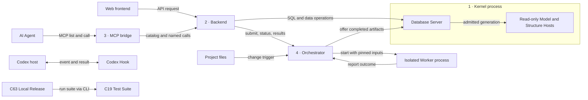
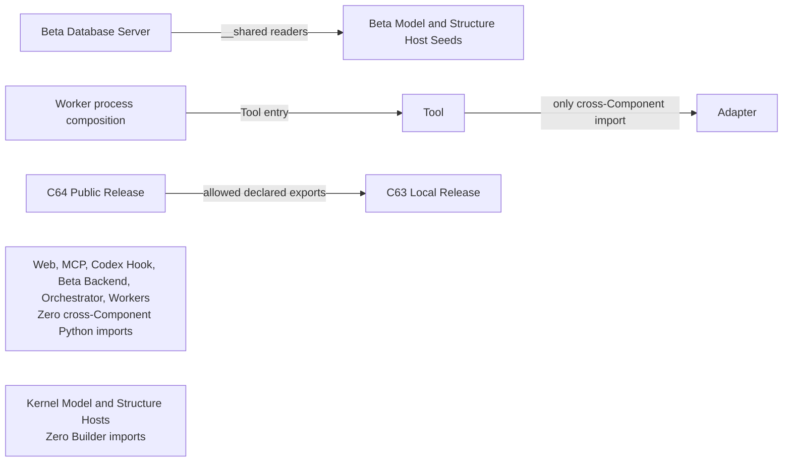

## Summary

Define and apply Component import boundaries

## Status

The Operator resumed the Epic with `/goal complete the epic`.
AN-T-2972 completed the first behavioral testing task.

## Objective

Give each current Component an authored Contract and declare the Code Access,
state, and interfaces that its Realization needs.

## Review checkpoint

- **Behavioral baseline.** AN-T-2972 reviewed the last 48 hours of MCP
  errors. The new session health probe, query canary, and Docker session
  continuity test passed. The real MCP and Backend exercise Project Tool
  exclusions, Lifecycle results, and their saved references. This
  coverage replaced the isolated blacklist and Lifecycle provider tests.

- **Framework Delivery (C27).** The current Python scan found zero imports
  outside the Release subtree. The three resolved imports within it dispatch
  to Local Release (C63) and Public Release (C64).
- **Release interfaces.** Local Release calls the C19 Test Suite CLI for
  static and functional checks, then end-to-end and canary checks on the
  candidate image. Public Release drafts the PR description
  and brief Version History entry from completed Tickets and a Luna review of
  the pinned Git diff. Contracts and exact bindings are in place for C27,
  C63, and C64.
- **Entry Modules and manifests.** The implemented entry Modules use
  `__shared` and `__pub`. AN-T-2945 and AN-T-2946 still need coverage checks
  for each Component and its code-bearing Packages. Use `boundaries.code`
  for Code Access in AN-T-2945.
- **Engine Studio (C14).** Backend owns Tool discovery, Project routing,
  dispatch, and Tool failure results. MCP maps the Backend JSON API. The
  realization graph finds zero MCP production cross-Component imports or
  unresolved production sites. The MCP package binds AN-S-3191@3. Its
  C45 Project admission and host settings calls supply the Manifest binding
  and the startup settings declared in AN-S-3044.
- **Realization Graph.** The updated Python graph resolved 1,327
  cross-Component imports with zero denied and zero unresolved sites.
  Each of the seven Packages with Beta implementation code has one
  `__shared` entry Module. Both Beta cross-Package imports use those
  entries. Codex Hook (C49) has zero production cross-Component imports.
- **Runtime Setup (C65).** The scan confirmed zero resolved cross-Component
  imports. The installation work is complete in standalone Task AN-T-2969.
  The shared settings entry is declared in AN-S-3296.
- **Component Contracts.** Workbench verifies 19 exact bindings. C24 and
  C52 now cover the frozen review query and bundled Model classes.
  AN-T-2984 tracks how to bind guarantees that children provide jointly.
  AN-T-2982 tracks the Kernel live Run data needed to update its archived pin.

## Solution

### Approach

Studio Beta has four core Components. Kernel owns the Project database.
Orchestrator owns workflow and Worker run state. Workers perform jobs.
Backend serves Web and MCP. Backend calls Kernel for interactive SQL and
calls Orchestrator for job submission, status, and results.

Kernel contains the Database Server, Model Host, and Structure Host.
The Database Server owns Project databases, connections, and transactions.
Its Query Engine serves admitted SQL and its Projection Store owns the
admitted projections. The read-only Hosts expose the accepted Model and
Structure in the Kernel process. Kernel activates compatible artifacts
together and keeps the previous generation available when a build fails.

Orchestrator receives Project file events and job requests. It owns
workflow transitions, job outcomes, and Worker run records. Each Worker
runs in an isolated process for one job or a bounded batch, uses pinned
inputs, and returns its result or artifacts to Orchestrator. Orchestrator
offers build artifacts to Kernel for admission.

### MCP bridge

Backend owns the APIs available to AI Agents and publishes their Tool
catalog as JSON. Each exposed entry provides the Tool name, description,
and input schema. Use the same Backend definitions for catalog entries
and dispatch.

MCP maps catalog entries to MCP Tools, forwards the Tool name, arguments,
and request context to Backend, then returns the result or failure through
MCP. Backend owns Project admission, Tool availability, and operation
validation. MCP can read the Project Manifest and runtime settings
through declared calls.

Verify catalog parity and forwarding through the real MCP and Backend
processes. Cover Project-specific availability, invalid requests, and
provider failures. Verify zero production cross-Component imports from MCP.

The Codex Hook processes host input and returns output to the host.
C27 Framework Delivery exposes the `local` and `public` Release commands.
Local Release calls the Test Suite through its public CLI. Public Release
can use declared Local Release interfaces.

### Processes and calls

1. **Kernel** runs the Database Server and the read-only Hosts.
2. **Backend** runs as a long-lived, stateless API process.
3. **MCP** runs as a separate long-lived bridge process.
4. **Orchestrator** has its own long-lived process in the proposed Beta
   comparison. Its job interface and state have the same owner throughout
   the comparison.

Each Worker process starts for a job or bounded batch and exits when it
finishes.

### Code imports

This is the target import structure. Process calls use public interfaces. Where code imports a client entry
Module, record the exact export in the caller's allowance. Tools import
only Adapters across Components. Adapters import zero other Components.
Web, MCP, and the Hook have zero cross-Component imports. The Kernel's
reader interfaces import zero Builder code.

Record exact providers and entry Modules in Component Manifests. Bind
their Contracts to the owning Packages for the target architecture.
See Spec Proposal `AN-T-2958@1-draft` for detailed rules and acceptance
checks.

## Execution order

1. **Add behavioral tests.** Start with AN-T-2972. Review the most recent
   48 hours of MCP errors and add end-to-end or canary regression coverage
   for verified bugs. Exercise successful requests, refusals, and
   recovery through the real CLI and API. Run end-to-end checks across
   Components on the exact candidate image. Keep the canary short: verify
   startup, initialize MCP, and execute one representative query.
2. **Fix forbidden cross-Component imports.** Refresh the graph, then work
   from the highest Layer down. Verify each repair with the matching
   behavioral checks. Track unresolved sites separately from confirmed
   violations and keep Package-only findings outside this pass.
3. **Apply source size limits.** Use 300 lines per file and 45 lines per
   function as review targets during repairs. Enforce the limits across
   the applicable source once the Component boundaries are settled.
4. **Retire redundant unit tests.** For each removal, identify the
   behavioral check that covers its guarantee. Replace the release unit
   gate with fast functional checks and linting when that coverage is ready.

Continue with the parallel Beta rewrite in AN-T-2976. Reuse the behavioral
gates for both images and record current-stack discrepancies during the
comparison.

## Work

1. Preserve the verified MCP bridge through the Backend JSON catalog and
   named API dispatch. Track current-stack import findings separately
   from the Beta architecture evaluation in AN-T-2976.
2. Complete AN-T-2945. Declare Code Access under `boundaries.code`. Record
   runtime interfaces under `boundaries.io` and owned state under
   `boundaries.state`.
3. Complete AN-T-2946. Check each code-bearing Package separately. Prefer
   one `__shared` entry Module for the parent and siblings. Add `__pub`
   when a public interface is needed. Keep implementation Modules unmarked
   and Package-local.
4. Complete AN-T-2947. Write each Component Contract with a verifiable
   guarantee and implement its interface.
5. Complete AN-T-2948. Bind exact Contract revisions to their Realization
   Packages.
6. Build the four Beta Components alongside the current stack. Review the
   candidate child Components and Seeds in AN-T-2958 before assigning
   their identities. Compare both images through their real entry points.
