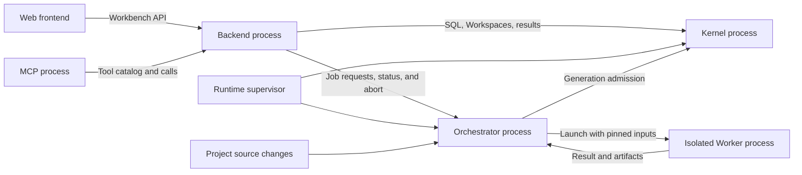

## Summary

Define target Component import and call boundaries

## Proposal

Studio Beta has four core Components. Kernel owns the Project database.
Orchestrator owns workflow and Worker run state. Workers perform jobs.
Backend serves Web and MCP. Backend calls Kernel for interactive SQL and
calls Orchestrator for job submission, status, and results.

Orchestrator receives Project file events and job requests. It owns
workflow transitions, job outcomes, and Worker run records. Each Worker
runs in an isolated process for one job or a bounded batch, uses pinned
inputs, and returns its result or artifacts to Orchestrator. Orchestrator
offers build artifacts to Kernel for admission.

Backend sends explicit projection rebuilds to Orchestrator. Orchestrator
serializes them with file-triggered builds. Kernel commits a rebuilt
generation and its retained-result refresh together.

Declare code access, runtime interfaces, and owned state in Component
Manifests. Bind exact Contract revisions to their Realization Packages.

### Process structure

1. **Kernel** runs the Database Server and the read-only Hosts.
2. **Backend** runs as a long-lived, stateless API process.
3. **MCP** runs as a separate long-lived bridge process.
4. **Orchestrator** has its own long-lived process in the proposed Beta
   comparison. Its job interface and state have the same owner throughout
   the comparison.

Runtime Setup supervises the per-Project Kernel and Orchestrator. Their
lifetime is independent of Backend and MCP. A restarted Backend or MCP
reconnects to the same Project binding. Kernel owns the accepted
projection. Orchestrator owns active runs and their outcomes.

Restart Backend and MCP independently after an exit. If Kernel or
Orchestrator exits, replace the bound pair and re-admit its Project
before serving queries. Other Projects keep their active peers.

A generation request starts a Worker independently of API requests and
Kernel queries. Orchestrator reports the run ID, Worker liveness, and
terminal outcome. An explicit abort stops the matching Worker and its
children before admission. Kernel completes or rolls back admission in
one transaction. A live Worker can continue until completion or abort.

Run this topology in one container. Keep the existing container memory
limit and host OOM behavior.

One Kernel transaction keeps the admitted data and artifacts together.
Short-lived Workers release their resources after each job. A shared
Backend can serve several Projects through their own Kernel and
Orchestrator peers.

### Kernel structure

- **Database Server** is a child Component of Kernel. It owns each
  Project database, its connections, and its transactions. Backend sends
  SQL and data requests to its API.
  - **Query Engine** admits and executes read-only SQL and serves query
    results. Its candidate Seed is `read_only_sql`.
  - **Projection Store** owns the admitted projections. Its candidate
    Seed is `activate_generation`, which activates a compatible Model
    and Structure together and keeps the accepted generation available
    if a build fails.
- **Model Host** and **Structure Host** are Kernel Seeds. They expose
  the same accepted generation through read-only interfaces in the
  Kernel process. Their Package names use `model_host` and
  `structure_host`.
  Kernel admits the paired artifacts and their query rows in one
  transaction. A failed build leaves the accepted generation available.
  A private disk database can reopen the accepted generation. Kernel
  owns durable Workspace documents and transient query results. Keep
  Journal storage independent of projection storage.
- Build native revision and relation rows against the attested Model.
- Build the Realization Graph in a Worker. Admit it in the same Kernel
  transaction. Orchestrator watches the Project's code and dependency
  inputs while the Graph is enabled.

### Other candidate child Components and Seeds

| Component | Child Components and responsibilities | Candidate Component Seeds |
| --- | --- | --- |
| Orchestrator | Workflow Runs owns job transitions and outcomes. Worker Runs owns process attempts, status, and cleanup. | Workflow Runs owns `file_trigger`. Worker Runs owns `worker_launch`. |
| Workers | Manifest Build emits compatible Model and Structure artifacts. Graph Build emits projection inputs. Tool Jobs executes admitted job operations. | Manifest Build owns `structure_snapshot`. Graph Build owns `python_import_scan`. |
| Backend | Project Admission binds the selected Project and runtime settings. Workbench API exposes queries and results. Tool API owns catalog, dispatch, and job routes. | Project Admission owns `project_binding`. Tool API owns `tool_catalog`. |

Give a Seed one focused implementation Module and one Manifest with an
independently verifiable guarantee. Place its tests and exact Spec Binding
inside the Seed Package. Assign Component and Seed IDs when authoring
their Manifests.

### First comparison

Build distinct images for each stack and bind each run to its image ID.
Use separate copies of the same Project fixture. Admit the Project through
Backend. Confirm that a real Manifest Build Worker runs under Orchestrator
and Kernel publishes its artifacts. Query a Project row through Backend and
MCP. Repeat after a Component Manifest revision and verify recovery after a
failed build. Record differences against the applicable Contracts.

Name a parallel Beta Component `<component name>_beta_<new component ID>`.
For example, the Beta counterpart of `KERNEL_MIXER_C59` is
`KERNEL_MIXER_beta_C67`.

`LAYER_5_FRAMEWORK_DELIVERY/project.toml` has one build setting.
`stack = "current"` selects the current Components.
`stack = "beta"` selects the parallel Beta Components as one set.
The selected stack also chooses the candidate tag role. Use `test` for
Current and `beta` for Beta. Apply `prod` after production readiness.
Each image builder includes the selector in its source identity and uses
the same Project fixture settings for the comparison. AN-T-2985 tracks
verification of both selections.

### Entry points and Code Access

Web and MCP reach Backend through its API with zero cross-Component
imports. The MCP bridge uses the Backend catalog and named call interface.
The Codex Hook returns its result to the host with zero outbound calls.

Each Tool imports only Adapters across Component boundaries. Adapters
import zero other Project Components. Worker composition supplies the
Database Server operations authorized for the job. The read-only Hosts
load accepted artifacts with zero Builder imports. The Model and Structure
artifacts carry matching fingerprints.

### Framework Delivery and Runtime Setup

Framework Delivery (C27) dispatches to Local Release (C63) and Public
Release (C64). Public Release may use declared Local Release interfaces.
Local Release has zero imports or calls to Public Release. Release imports no
Project code outside its subtree. Local Release calls the Test Suite (C19)
through its public CLI. Runtime Setup (C65) imports zero other Project
Components and uses declared runtime interfaces.

The existing Component Contracts define the release and installation
interfaces and guarantees. See AN-S-3288@5, AN-S-3292@3, AN-S-3293@3,
and AN-S-3297@1.

### Code Access

Declare Code Access under `boundaries.code`. Unmarked and undeclared
entries are private to the owning Package. An entry Module may carry
public and shared exports. Omitted export visibility defaults
to shared for the parent and siblings; an explicit export may grant access
to named callers.

Direct children, siblings, and public entries are eligible imports by
default. An imports list adds named dependencies. An `only` list admits
its named dependencies exclusively. An empty `only` admits zero
cross-Package imports. Every cross-Package
import must satisfy both caller and provider rules. Within an ordered
sibling group, dependencies point from higher to lower layer numbers.
This order applies to allowlisted dependencies.

Record the exact provider and entry Module for each permitted import.

Each Package with direct authored code has one `__shared` entry
Module. The rule also applies to ordinary nested Packages and Test
Packages. Use that entry for cross-Package imports by default.
Declare broader exports on the entry when the Contract requires them.
An exact import and export declaration can permit a direct import.
Visibility, inherited import restrictions, and layer order still apply.
Use declared process interfaces
between Beta services. The static Test Suite limits each module to
300 nonblank lines and each function to 45 nonblank lines.

The Realization Graph records each Package's direct third-party imports.
Only dependencies outside the Project and its language runtime belong in
this inventory. Keep unresolved import names available for review.

Import symbols from the Package that defines them. The static Test Suite
traces named imports through the Realization Graph. A Package entry can
expose symbols from its own implementation Modules.

Consider public visibility for a named entry export when the Realization
Graph shows authorized production use by at least two independent
Component families outside the provider's family. Require a stable
guarantee in the owning Contract and a reason for other callers to use it.
Keep test fixtures, bootstrap code, and private process interfaces scoped.
The graph proposes candidates. The owner decides visibility and records
the named export. Caller import rules and layer order still apply.

Consider moving a child Component to peer level when it owns an
independent capability and several Components at that level use its
Contract directly. Place it under their common owner. Check the proposed
dependency direction for cycles before moving it. Use a lower layer for
the provider when the peer group needs one-way dependencies.

Keep declared direct imports visible in the graph. Use recurring bypasses
to identify owners that may belong at a higher structural level. Review
wrapper-only migrations in AN-T-2986.

### Runtime interfaces

Declare client and server interfaces under `boundaries.io`. A client names
the provider Component and interface. The provider declares the transport
and its invocation details. Process calls use public interfaces. An
import of a client entry Module also needs an exact Code Access allowance.
Declare the owning Component for persisted state under `boundaries.state`.

## References

AN-T-2944, AN-T-2976, AN-S-3013, and AN-S-3179.

Manifest Runtime Contracts AN-S-3089@1, AN-S-3090@1, AN-S-3091@1, and
AN-S-3186@1.

Component Contracts AN-S-3288@5, AN-S-3292@3, AN-S-3293@3, and AN-S-3297@1.
