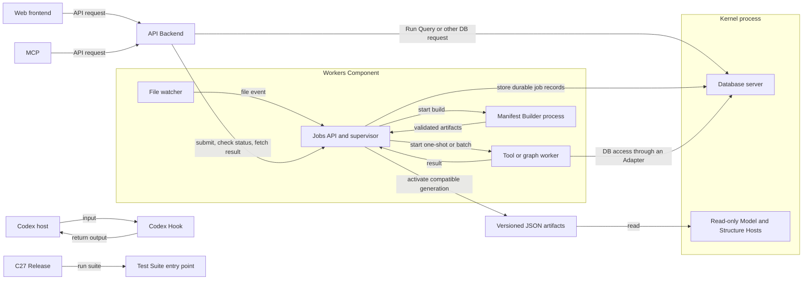
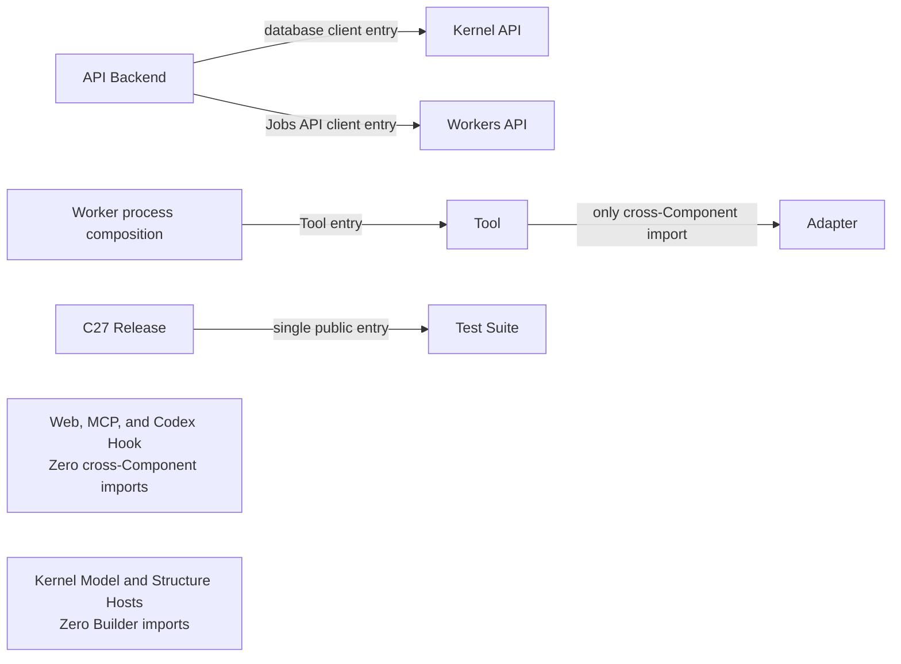

## Summary

Define and apply Component import boundaries

## Objective

Give each current Component an authored Contract and declare the Code Access that its Realization needs.

## Solution

### Approach

Use three server-side Components. The API Backend serves Web and MCP.
It calls the Workers API for job submission, status, and results. It
calls the Kernel directly for database requests. Interactive Run Query
uses this direct path, so a query can return without starting a worker.

The Kernel is the database server for each Project. Its Model Host and
Structure Host are read-only interfaces in the same process. They expose
one compatible generation of JSON schemas and Structure data.

The Workers supervisor receives file events and starts one-shot or batch
workers. Tool operations, graph builds, and the Manifest Builder run
there. The supervisor owns the job lifecycle and stores durable job
records through the Kernel. A separate Builder process releases its
build memory at exit. Publish a compatible Model and Structure generation
atomically and keep the previous generation available on failure.

The Codex Hook processes host input and returns output to the host.
C27 Framework Delivery imports and calls the single public Test Suite
entry point.

### Processes and calls

Arrows show runtime calls, host input and output, or artifact handoffs.

### Code imports

Process calls use public interfaces. Where code imports a client entry
Module, record the exact export in the caller's allowance. Tools import
only Adapters across Components. Adapters import zero other Components.
Web, MCP, and the Hook have zero cross-Component imports. The Kernel's
reader interfaces import zero Builder code.

Record exact providers and entry Modules in Component Manifests. Bind
their Contracts to the owning Packages before changing caller imports.
See Spec Proposal `AN-T-2958@1-draft` for detailed rules and acceptance
checks.

## Work

1. Declare Code Access in Component Manifests.
2. Give each code-bearing Package a `__family_pub` entry Module for its parent and siblings. Prefer one such entry Module and add an optional `__pub` entry Module. Keep implementation Modules unmarked and Package-local. Apply the rule separately to each Package.
3. Write each Component Contract and implement its code interface.
4. Bind exact Contract revisions to their Realization Packages.
5. Resolve forbidden imports after Tasks 1–4 pass. Use Component Seed as the name for a Package with its own Spec that may later become a Component.
