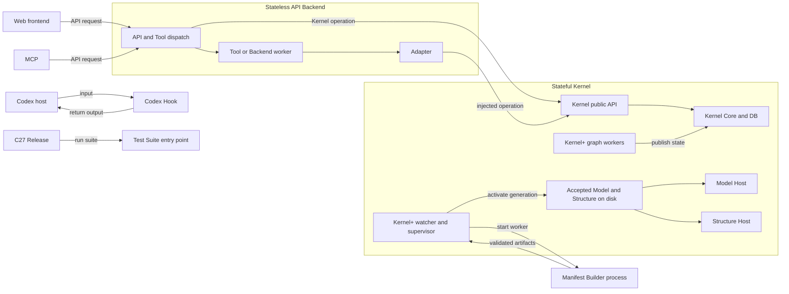
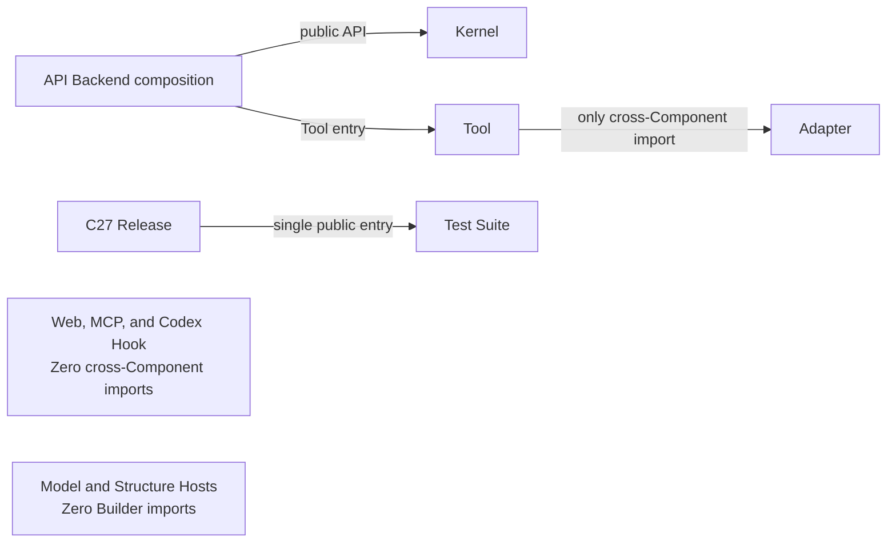

## Summary

Define and apply Component import boundaries

## Objective

Give each current Component an authored Contract and declare the Code Access that its Realization needs.

## Solution

### Approach

Use two server-side Components. The stateless API Backend handles API
requests, selects Tools, and supplies Adapters with the Kernel operations
they need. The stateful Kernel owns authoritative state for each Project.
Kernel Core alone controls DB access, transactions, and state invariants.

Web and MCP use the API. The Codex Hook processes host input and returns
output to the host. Keep Tool workers in the Backend and source and graph
workers in Kernel+. This keeps dispatch separate from state ownership and
lets workers run in separate processes when needed.

Kernel+ runs the Manifest Builder in a short-lived worker. It publishes
a compatible Model and Structure generation atomically. Thin read-only
hosts expose the accepted artifacts from disk. Each operation holds one
generation, and a failed build leaves the last accepted one available.

C27 Framework Delivery imports and calls one public Test Suite entry point.
The suite owns discovery, fixtures, and execution, and returns its outcome
and report to C27.

### Processes and calls

Arrows show runtime calls, host input and output, or artifact handoffs.
The Manifest Builder is a separate process. A host can be a reader entry
point, with its own process when it needs to serve requests or share a cache.

### Code imports

Arrows show allowed code imports across the named boundaries. Each Tool
imports only Adapters across Components. Adapters import zero other
Components. Web, MCP, and the Hook have zero cross-Component imports.
The Model and Structure Hosts read artifacts with zero Builder imports.

Record exact providers and entry Modules in Component Manifests. Bind
their Contracts to the owning Packages before changing caller imports.
See Spec Proposal `AN-T-2958@1-draft` for detailed rules and acceptance
checks.

## Work

1. Declare Code Access in Component Manifests.
2. Give each code-bearing Package a `__family_pub` entry Module for its parent and siblings. Prefer one such entry Module and add an optional `__pub` entry Module. Keep implementation Modules unmarked and Package-local. Apply the rule separately to each Package.
3. Write each Component Contract and implement its code interface.
4. Bind exact Contract revisions to their Realization Packages.
5. Resolve forbidden imports after Tasks 1–4 pass. Use Component Seed as the name for a Package with its own Spec that may later become a Component.
